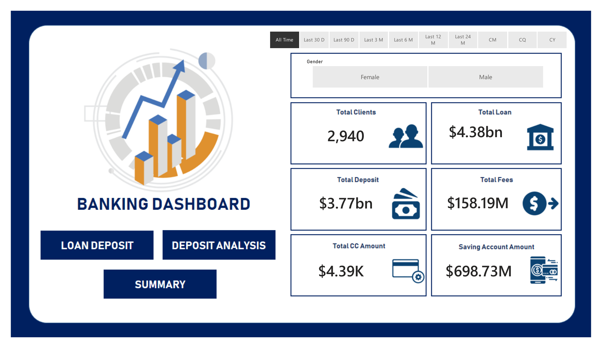
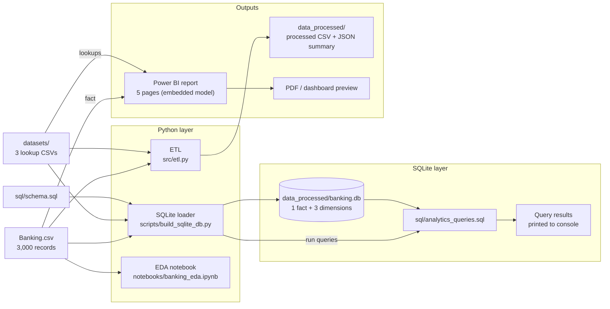

# Banking Portfolio Analytics Platform

[](https://www.python.org/)
[](./sql/)
[](./powerbi/)
[](./tests/)

An end-to-end Data Analytics and Business Intelligence project exploring customer demographics, liquidity concentration, credit exposures, and fee yields across **3,000 banking records (2,940 distinct clients)**.

The project includes a **SQLite star schema with analytical queries**, an **automated Python ETL pipeline**, **10 data-quality tests**, a **reproducible database builder**, a **Jupyter EDA notebook**, and a **5-page Power BI dashboard**.

> **Analytical scope:** This is descriptive customer and portfolio analytics. The dataset contains no default, repayment, approval, or loss outcomes, so it must not be presented as a credit-underwriting or loan-default prediction model.

---



---

## Architecture & Data Flow



Power BI uses an embedded model built from `Banking.csv` and the three lookup CSVs; the notebook reads `Banking.csv` directly. The ETL outputs in `data_processed/` are reproducible artifacts and are not a runtime dependency for the notebook or the Power BI report.

---

## Project Highlights

- **3,000 banking records / 2,940 distinct clients** across 25 demographic, asset, debt, and loyalty fields.
- **SQLite star schema** (1 fact table + 3 dimensions) with **7 analytical queries**: 6 business queries (including `NTILE`, `DENSE_RANK`, and CTE-based analysis) plus a duplicate-client audit.
- **Automated Python ETL pipeline** that standardizes types, joins dimensions, engineers derived metrics, and writes a processed CSV plus JSON summary to `data_processed/`.
- **10 automated data-quality tests** covering file integrity, UTF-8 encoding, schema/row-count contracts, client-ID collisions, referential integrity, advisor coverage, and non-negative financial invariants.
- **5-page Power BI report** covering Home, Loan Analysis, Deposit Analysis, Summary, and a client-detail drill-through.
- **One-command database build** so the SQL layer is reproducible without manual CSV imports.

---

## Repository Layout

```text
.
├── Banking.csv                         # Canonical fact dataset (3,000 records)
├── README.md                           # Project documentation and portfolio overview
├── requirements.txt                    # Python environment dependencies
│
├── datasets/                           # Dimensional lookup tables
│   ├── banking-relationships.csv       # BRId -> Banking Relationship
│   ├── gender.csv                      # GenderId -> Gender
│   ├── investment-advisors.csv         # IAId -> Investment Advisor
│   └── README.md
│
├── docs/                               # Metric and DAX documentation
│   ├── dax_measures.md                 # DAX measures, grain notes, formatting caveats
│   └── metrics.md                      # Metric definitions, verified figures, limitations
│
├── images/                             # Dashboard previews
│   └── dashboard_home.png
│
├── notebooks/                          # Exploratory data analysis
│   └── banking_eda.ipynb
│
├── powerbi/                            # Business intelligence model
│   ├── banking_dashboard.pbix          # 5-page Power BI report
│   └── banking_dashboard.pdf           # Exported visual preview
│
├── scripts/                            # Reproducible SQLite build
│   └── build_sqlite_db.py
│
├── sql/                                # SQL analytics layer (SQLite dialect)
│   ├── schema.sql                      # Star-schema DDL, constraints, indexes
│   └── analytics_queries.sql           # KPI, decile, cohort, fee, and audit queries
│
├── src/                                # Python ETL
│   ├── __init__.py
│   ├── config.py                       # Centralized paths and thresholds
│   └── etl.py                          # Ingestion, cleaning, enrichment, output
│
└── tests/                              # Automated data-quality suite
    ├── __init__.py
    └── test_data_quality.py            # 10 unittest/pytest checks
```

---

## Relational Data Model

`Banking.csv` is the fact table, joined to three dimension tables via surrogate integer keys:

| Dimension | Primary Key | Join Field in Fact | Purpose |
| :--- | :--- | :--- | :--- |
| [`datasets/gender.csv`](./datasets/gender.csv) | `GenderId` | `GenderId` | Maps gender identifiers |
| [`datasets/banking-relationships.csv`](./datasets/banking-relationships.csv) | `BRId` | `BRId` | Maps relationship tiers |
| [`datasets/investment-advisors.csv`](./datasets/investment-advisors.csv) | `IAId` | `IAId` | Maps designated advisors |

**Grain note:** the fact table has **3,000 records** but only **2,940 distinct client IDs**. 59 client IDs appear more than once (60 extra records) because of synthetic ID collisions. The SQL and Power BI models therefore use `COUNT(DISTINCT client_id)` / `DISTINCTCOUNT` for client-level KPIs, while record-level analysis uses the row count.

---

## Core Business Findings

1. **Liquidity concentration is real.**
   Bank Deposits correlate strongly with Checking Accounts (**r = 0.84**) and Saving Accounts (**r = 0.76**).
   *Strategy:* use automated sweep accounts and tiered deposit products to retain liquidity in higher-margin instruments.

2. **The portfolio is loan-heavy.**
   Total deposits are **$3.77B** against **$4.38B** in loans, producing a **116.4% loan-to-deposit ratio**.
   *Strategy:* monitor funding mix and deposit growth; treat LDR as a descriptive portfolio ratio, not a risk model.

3. **Fee revenue is concentrated in the High fee tier.**
   The High fee structure represents **67.7%** of **$158.2M** estimated fees. By income band, Mid-income clients generate **54.0%** of fees, Low-income **24.8%**, and High-income **21.2%**.
   *Strategy:* review retention and pricing for high-fee-tier clients, and do not assume fee tier and income tier are the same population.

4. **The high-value segment should be defined by the top decile, not $150k.**
   The top decile of total deposits starts at **$2.72M** and contains **300 records**. Only **5** of those records have no bank loan. There are **22 advisors** with 88–177 records each (87–177 distinct clients), and every record has an advisor ID.
   *Strategy:* prioritise top-decile clients for advisor review and use advisor caseload/coverage — there is no "unassigned advisor" population in this dataset.

5. **Cross-sell whitespace is limited.**
   99.1% of records have a bank loan, 99.5% have business lending, 100% have a credit card balance, and 98.9% have deposits/savings/checking. Only **27** records have no bank loan and **14** have no business lending.
   *Strategy:* focus on deepening product usage and balance growth rather than assuming large untapped product gaps.

6. **Client-ID collisions are a documented data-quality issue.**
   59 client IDs repeat across 3,000 records. Client-level reporting uses distinct counts; record-level analysis stays explicit about its grain.

---

## Data Quality & Limitations

- **Synthetic snapshot, not a transaction ledger.** The data has no dates of individual transactions, defaults, repayments, approvals, or losses. It supports descriptive segmentation only.
- **Client-ID collisions.** 3,000 records map to 2,940 distinct clients; use distinct counts for client KPIs.
- **No unassigned advisors.** Every record has an `IAId`; 22 advisors cover 88–177 records each (87–177 distinct clients). Because 54 duplicated client IDs map to more than one advisor, client-level caseload is approximate.
- **The $150k deposit cutoff is not selective.** It captures 94.5% of records. Use the top decile ($2.72M+) or top quartile ($1.74M+) for high-value segmentation.
- **Total CC Amount is a count.** The PBIX tile is currently formatted as currency; the underlying `Amount of Credit Cards` field should be formatted as a whole-number card count.
- **SQL dialect is SQLite.** The schema uses `AUTOINCREMENT` and the queries use `strftime`. PostgreSQL requires identity columns and `EXTRACT`/`DATE_TRUNC` equivalents.

---

## How to Run & Verify

### 1. Run the data-quality tests

```bash
python3 -m unittest discover tests
# Or with pytest
pytest tests/
```

### 2. Run the Python ETL pipeline

```bash
python3 -m src.etl
```

This writes:

- `data_processed/banking_clients_processed.csv`
- `data_processed/etl_summary.json`

### 3. Build the SQLite database and run the analytics queries

```bash
python3 scripts/build_sqlite_db.py --run-queries
```

This creates `data_processed/banking.db`, loads all dimensions and the fact table, and prints the results of the seven analytical queries. You can also open the database in any SQLite client.

### 4. Run the EDA notebook

```bash
python3 -m venv .venv
source .venv/bin/activate  # On Windows: .venv\Scripts\activate
pip install -r requirements.txt
jupyter notebook notebooks/banking_eda.ipynb
```

### 5. Open the Power BI report

Open [`powerbi/banking_dashboard.pbix`](./powerbi/banking_dashboard.pbix) in Power BI Desktop. The exported [`banking_dashboard.pdf`](./powerbi/banking_dashboard.pdf) is a shareable preview.

---

## Resume Bullet Format (STAR Method)

> Built an end-to-end banking analytics portfolio project on 3,000 records (2,940 distinct clients): designed a SQLite star schema with six business queries (including `NTILE`, `DENSE_RANK`, and CTE-based analysis); automated a Python ETL pipeline with 10 data-quality tests; and delivered a 5-page Power BI dashboard that quantified a 116.4% loan-to-deposit ratio and a $158.2M estimated fee base.
