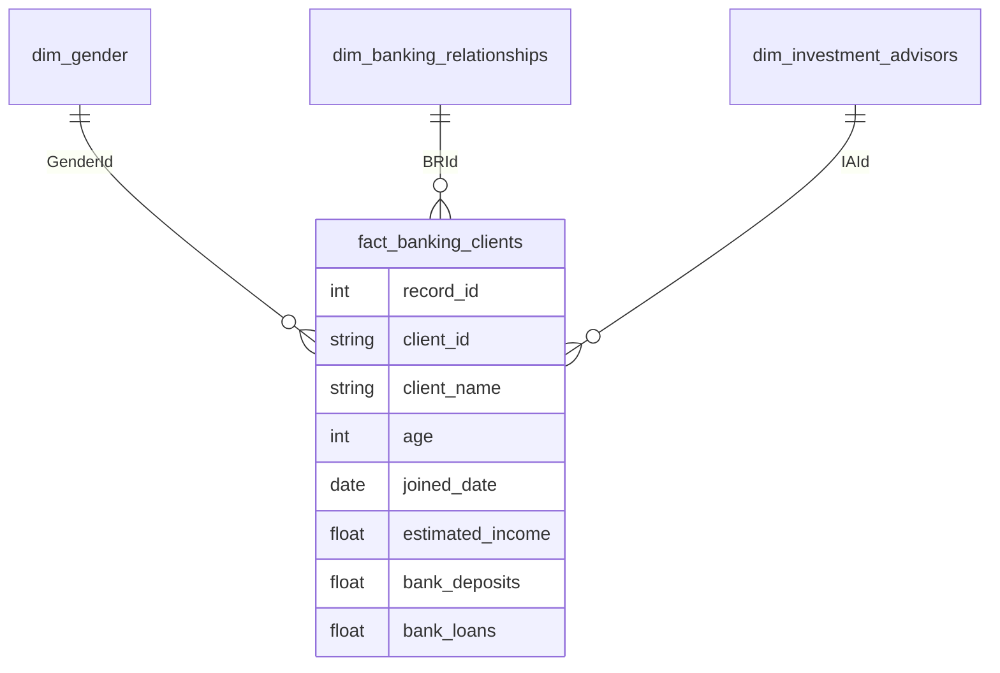

# Power BI & DAX Measure Reference

This document catalogs the analytical measures and calculated columns used in `powerbi/banking_dashboard.pbix`, plus a recommended top-decile segment measure. It is intended to make the report logic reviewable without opening the PBIX file.

> **Grain note:** the model has 3,000 banking records and 2,940 distinct client IDs. Client-level measures must use `DISTINCTCOUNT`, not `COUNTROWS`.

---

## 1. Portfolio Volume & Balance Measures

### Total Clients
Counts distinct clients in the portfolio (accounting for synthetic ID collisions).
```dax
Total Clients =
DISTINCTCOUNT('Clients - Banking'[Client ID])
```

### Banking Records
Counts fact rows; use this only when the analysis is explicitly record/account-level.
```dax
Banking Records =
COUNTROWS('Clients - Banking')
```

### Total Deposits
Aggregates customer liquidity across all deposit and savings instruments.
```dax
Total Deposits =
SUM('Clients - Banking'[Bank Deposits]) +
SUM('Clients - Banking'[Saving Accounts]) +
SUM('Clients - Banking'[Checking Accounts]) +
SUM('Clients - Banking'[Foreign Currency Account])
```

### Total Loans
Calculates total gross lending exposure across retail, commercial, and revolving debt.
```dax
Total Loans =
SUM('Clients - Banking'[Bank Loans]) +
SUM('Clients - Banking'[Business Lending]) +
SUM('Clients - Banking'[Credit Card Balance])
```

### Loan-to-Deposit Ratio (LDR)
Standard banking liquidity metric assessing lending exposure relative to client deposit funding. The current portfolio LDR is **116.4%**.
```dax
Loan to Deposit Ratio =
DIVIDE([Total Loans], [Total Deposits], 0)
```

---

## 2. Calculated Columns

### Income Band
Segments clients into standardized economic tiers:
- **Low:** $\le \$100,000$
- **Mid:** $\$100,001 - \$300,000$
- **High:** $> \$300,000$

```dax
Income Band =
SWITCH(
    TRUE(),
    'Clients - Banking'[Estimated Income] <= 100000, "Low",
    'Clients - Banking'[Estimated Income] <= 300000, "Mid",
    "High"
)
```

### Processing Fee Rate
Assigns the fee assessment percentage based on client tier structure:
```dax
Processing Fee Rate =
SWITCH(
    'Clients - Banking'[Fee Structure],
    "High", 0.05,
    "Mid", 0.03,
    "Low", 0.01,
    0.01
)
```

### Engagement Days
Calculates client tenure duration from account opening to report refresh date:
```dax
Engagement Days =
DATEDIFF('Clients - Banking'[Joined Bank], TODAY(), DAY)
```

---

## 3. Revenue & Fee Yield Measures

### Total Processing Fees
Row-level calculation evaluating fee yields earned across client credit facilities:
```dax
Total Fees =
SUMX(
    'Clients - Banking',
    ([Total Loans] * 'Clients - Banking'[Processing Fee Rate])
)
```

### Average Fee Yield per Client
```dax
Average Fee Yield =
DIVIDE([Total Fees], [Total Clients], 0)
```

---

## 4. High-Value Deposit Segment

### High-Value Deposit Clients (Top Decile)
The old `$150,000` cutoff captured ~94.5% of records and was not a useful segment. Use a dynamic top-decile threshold instead; in the current data it is approximately **$2.72M**.
```dax
High Value Deposit Clients =
VAR Threshold =
    PERCENTILEX.INC('Clients - Banking', [Total Deposits], 0.90)
RETURN
    CALCULATE(
        [Total Clients],
        FILTER('Clients - Banking', [Total Deposits] >= Threshold)
    )
```

### Advisor Coverage Note
Every record has an `IAId`; the dataset contains 22 advisors with 88–177 records each (87–177 distinct clients). There is no "unassigned advisor" field, so do not report an unassigned-advisor ratio. Because 54 duplicated client IDs map to more than one advisor, advisor caseload is approximate at the client level. Use advisor caseload and top-decile coverage instead.

---

## 5. Formatting Note

The **Total CC Amount** tile is currently formatted as currency, but the underlying field (`Amount of Credit Cards`) is a count. In Power BI, change the measure aggregation to `SUM([Amount of Credit Cards])` and use a whole-number format with no currency symbol.

---

## Data Model & Relationships


